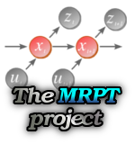

Title: Software
Date: 2026-01-27
Modified: 2026-01-27
myorder: 4
Summary: A collection of open-source frameworks and tools for robotics, multibody dynamics, and data acquisition.

## Profiles
* **GitHub**: [@jlblancoc](https://github.com/jlblancoc)
* **Packages**: [Debian/Ubuntu Developer Profile](https://qa.debian.org/developer.php?login=joseluisblancoc%40gmail.com)

---

## Core Robotics Frameworks

### **MOLA: Modular Optimization and Localization Abstraction**
The successor to the SLAM foundations of MRPT, **MOLA** is a modular, high-performance C++ framework designed for lifelong SLAM, localization, and mapping. It is built to be highly extensible through a plugin-based architecture.

* **Status**: Active / Most Relevant

* **Repository**: [github.com/MOLAorg](https://github.com/MOLAorg)

### **MRPT: Mobile Robot Programming Toolkit**

A mature, cross-platform C++ library (2005–present) providing developers with a vast collection of algorithms for robotics: SLAM, computer vision, and motion planning.

* **Highlights**: Extensive support for 2D/3D range sensors, probabilistic motion models, and real-time visualization.

* **Website**: [www.mrpt.org](http://www.mrpt.org/)

* **Repository**: [github.com/MRPT](https://github.com/MRPT)

---

## ROS Ecosystem
I maintain a wide variety of ROS and ROS 2 integrations to bridge high-performance C++ backends with the ROS middleware.

* **MRPT ROS Packages**: The official bridge between MRPT and ROS/ROS 2, including [`mrpt_navigation`](http://wiki.ros.org/mrpt_navigation) and [`mrpt_slam`](http://wiki.ros.org/mrpt_slam).

* **UAL ARM ROS**: Packages specifically for robotic arm control and integration.

* **GitHub Org**: [github.com/mrpt-ros-pkg](https://github.com/mrpt-ros-pkg) | [github.com/ual-arm-ros-pkg](https://github.com/ual-arm-ros-pkg)

---

## Specialized Engineering Organizations

### **Multibody Dynamics & Simulation (MBDS)**
Tools and libraries focused on the simulation of complex mechanical systems and multibody dynamics.

* **Repository**: [github.com/MBDS](https://github.com/MBDS)

### **LibreDAQ: Open Data Acquisition**
A collection of projects dedicated to open-source hardware and software interfaces for data acquisition.

* **Repository**: [github.com/LibreDAQ](https://github.com/LibreDAQ)

### **Mechanical Design & Structural Analysis**

* **Open-Beam**: Specialized tools for structural and beam analysis. ([github.com/open-beam](https://github.com/open-beam))

* **Mechplot**: A MATLAB library for rendering structures and mechanisms. ([github.com/jlblancoc/mechplot](https://github.com/jlblancoc/mechplot))

---

## Developer Tools & Utilities

* **SuiteSparse-METIS for Windows**: A CMake-based build system that enables the use of these powerful sparse matrix libraries in Visual Studio.

* **RWL (Recursive World Language)**: A domain-specific language and interpreter for generating vast simulated worlds for SLAM benchmarking.

* **Eigen**: Proud (though minor) contributor to this world-class C++ template library for linear algebra.

---

## Didactic & Historical Projects

* **Maxwell-Boltzmann Simulator**: A graphical simulator illustrating the kinetic theory of gases and probability distributions.

* **Denavit-Hartenberg GUI**: A visual tool for learning and teaching robotic arm kinematics.

* **OpenMORA (2008–2014)**: A middleware framework based on MOOS and MRPT. This was before ROS took off.

* **Open-CV Bots**: Experimental computer vision programs designed to autonomously play web-based games.

* **Syncpath**: A lightweight, cross-platform CLI tool for directory synchronization and backups.
